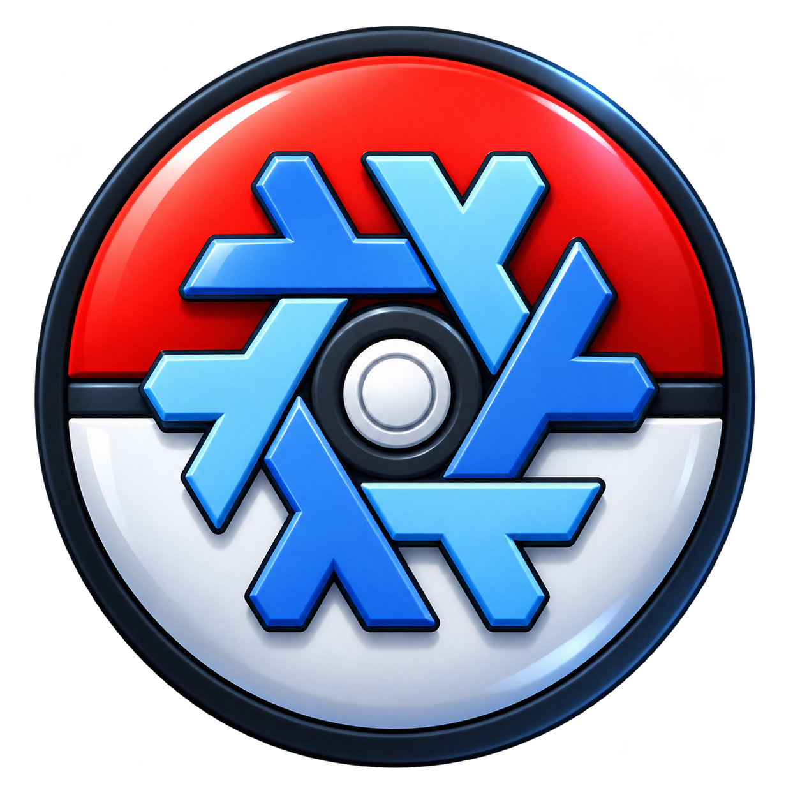

<div align="center">


<br>

[ "")](https://github.com/sponsors/QuackHack-McBlindy) [](https://buymeacoffee.com/quackhackmcblindy)


[](https://nixos.org)

</div>


# **PokéNix - Pokémon Collection Website Using NixOS**

**You** define your mons using the NixOS options.<br>
**PokéNix** builds your collection website.<br>


<br>


## **Installation**

<details><summary><strong>
❄️ Using flakes
</strong></summary>


#### **1: Add PokéNix as inputs in your flake.nix**

```nix
  inputs = {
    nixpkgs.url = "github:NixOS/nixpkgs/nixos-unstable";
    pokenix.url = "github:quackhack-mcblindy/pokenix";
  };
```


#### **2: Import the module into your configuration**


```nix
  imports = [
    pokenix.nixosModules.pokenix
  ];
```

</details>
<br>

## **License**

This project is licensed under the terms of the MIT license.<br>
See the `LICENSE` file in the repository for full details.<br>

Contributions are welcomed.


